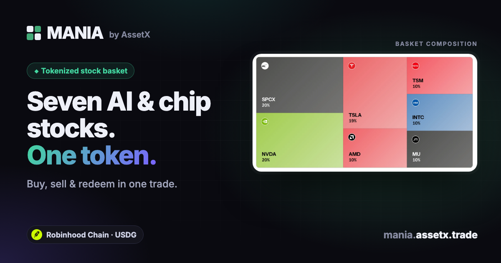

# MANIA

**One token. Seven AI & semiconductor stocks. Trade it from your own wallet.**

MANIA is a non-custodial storefront for the **MANIA basket**, a single ERC-20 token backed by fixed
quantities of seven tokenized stocks — NVIDIA, AMD, Micron, Intel, TSMC, Tesla and SpaceX — on
**Robinhood Chain** (EVM, chain id 4663). Buy, sell, deposit or redeem the whole basket in one transaction,
see its net asset value (NAV) and price history, and understand what you hold — without managing seven
separate positions.

Live: **https://mania.assetx.trade** · Status: beta



## What this project is (and isn't) — please read

This repository is the **frontend storefront and its small data proxy**. To be clear about scope:

- **The basket and its contracts are not ours.** MANIA is a basket created on **The Index's Blend** protocol.
  The vault, router, lens and hook contracts are Blend's; this app calls them directly from the browser using
  their published ABIs (in `src/blend/`). We did not write or deploy those contracts, and we make no claim
  about their security beyond what their authors publish.
- **What we built:** the storefront UI; live quote/preview flows for buy, sell, deposit and redeem; the
  transaction sequencing (exact-amount approvals, deadlines, slippage bounds, multi-token deposits);
  the NAV history chart computed from per-stock price history; the constituents and fee views; wallet
  support (browser wallets, Coinbase Wallet, WalletConnect); and a plain-language explainer for people new
  to baskets.
- **Part of a bigger product.** This app is the MANIA storefront of **AssetX**, a multi-chain swap
  interface by [AI·PIN](https://ai-pin.io). This repository contains only the MANIA-specific parts, not the
  rest of AssetX (its multi-venue swap router, portfolio, etc.).
- **No custody, no backend state.** The server side is one read-only caching proxy for public market data.
  Your wallet signs every transaction.
- **Not financial advice.** Tokenized stocks are blockchain tokens that track an underlying asset; they are
  not company shares and carry no ownership, voting or dividend rights. Not available to residents of the
  United States and other restricted jurisdictions.

## How it works

| Action | What happens on-chain |
|---|---|
| **Buy** | Pay USDG → router buys all seven legs and mints shares atomically (`router.buy`) |
| **Sell** | Approve shares → router sells all seven legs back to USDG (`router.sell`) |
| **Deposit** | Already hold all seven stock tokens? Approve each, then `vault.mint` |
| **Redeem** | `vault.redeem` returns the underlying stock tokens to your wallet |

Quotes come from the protocol's read-only lens contract (`quoteBuy`, `quoteSell`, `previewRedeem`) and the
vault's `previewMint`; the pool key is read from the hook contract (never rebuilt locally). Every transaction
sets a 20-minute deadline and minimum-output / maximum-input bounds from your slippage setting.

**NAV chart:** the basket holds fixed units of each stock, so NAV(day) = Σ units-per-share × close. The chart
is built from per-stock daily closes, fetched through the proxy.

## Architecture

```
Browser (React + wagmi/viem)
  ├─ reads/writes the basket contracts directly (quotes, buy, sell, deposit, redeem)
  └─ GET /api/blend/*  ──►  Cloudflare Pages Function (caching proxy)  ──►  public protocol data API
```

- `src/blend/` — the app: `ManiaApp` (page), `TradePanel` (all four flows), `NavChart`, `data` (queries),
  `ManiaAbout` (explainer), contract ABIs.
- `functions/api/blend/[[path]].js` — allow-listed, cached, read-only proxy. The upstream origin is
  configuration (`BLEND_API_ORIGIN`), not code.
- `public/_headers` — strict security headers (CSP, HSTS, no framing).

## Run it

```bash
npm install
cp .dev.vars.example .dev.vars        # set BLEND_API_ORIGIN (server-side, never committed)
cp .env.example .env.production       # optional: WalletConnect project id, RPC override
npm run build
npm run pages:dev                     # serves the app + the data proxy locally
```

Environment (all optional except the proxy origin):

| Variable | Where | Purpose |
|---|---|---|
| `BLEND_API_ORIGIN` | server (`.dev.vars` / Pages secret) | Base URL of the protocol's public data API |
| `VITE_WC_PROJECT_ID` | build | Enables WalletConnect (add your domain to the Reown allowlist) |
| `VITE_RPC_URL` | build | Override the Robinhood Chain RPC |

No API keys are required to read the chain. Nothing secret is committed; `.env*` and `.dev.vars` are ignored.

## Security notes

- Non-custodial: no keys, no custody, no server-held funds.
- Approvals are for the exact amount being traded, never unlimited.
- Contract addresses are fixed constants; the pool key is read from the protocol's hook contract.
- Security headers are set in `public/_headers`.

## Brand & attribution

- "Robinhood" and "Robinhood Chain" are trademarks of their respective owners. This is an independent
  project, not affiliated with, endorsed or sponsored by Robinhood. The Robinhood Chain logo in
  `public/brand/` is used unmodified, per Robinhood's published brand guidelines.
- The Index and Blend are the property of their respective owners; the basket is built on their protocol.
